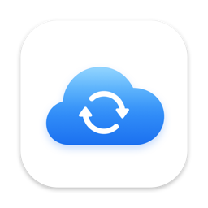

<p align="center">
  <picture>
    <source media="(prefers-color-scheme: dark)" srcset="docs/images/icon-dark.png">
    
  </picture>
</p>

<h1 align="center">Rclone GUI</h1>

<p align="center">A lightweight, native macOS app for browsing, previewing and backing up your cloud storage with rclone.</p>

<p align="center">
  
  
  <a href="https://rclone.org"></a>
  <a href="https://github.com/MIN202299/rclone-gui/releases/latest"></a>
  <a href="LICENSE"></a>
</p>

<p align="center"><b>English</b> · <a href="README.zh-CN.md">简体中文</a></p>

Built with SwiftUI and no third-party dependencies, it drives [rclone](https://rclone.org) under the hood. It uses your existing `rclone.conf`, so every remote you've already set up shows up automatically.

## Download

Get the latest `Rclone-x.y.z.dmg` from [**Releases**](https://github.com/MIN202299/rclone-gui/releases/latest), open it and drag **Rclone** into **Applications**. It runs on macOS 14+ on both Apple Silicon and Intel.

The app isn't notarized by Apple yet, so macOS blocks the first launch. Open **System Settings → Privacy & Security** and click **Open Anyway**, or run:

```bash
xattr -dr com.apple.quarantine /Applications/Rclone.app
```

## Features

- **Sidebar of remotes** with a type icon and a storage usage bar (from `rclone about`, for backends that support it).
- **Finder-style browser** with breadcrumbs, back/forward, a sortable Name/Size/Modified table, and a filter field. Native Google Docs, Sheets and Slides have no fixed size on Drive, so they show "--" until opened once; after that they show the size of the cached export.
- **File operations:** new folder, rename, delete (with a confirmation), and copy path, from the toolbar or the right-click menu. Items being deleted are dimmed with a spinner, and the status bar shows how many are done.
- **Upload** with the toolbar button or by **dragging files and folders from Finder** onto the list.
- **Download** to any folder.
- **Quick Look** works like in Finder. Select a file and press Space (or ⌘Y, or "Quick Look" in the right-click menu). The preview follows your selection while it's open, and "Open with Preview" is one click away.
- **File cache.** Opened and previewed files are kept in `~/Library/Caches/RcloneGUI/files`. If a file hasn't changed on the remote (same size and modification time as in the folder listing), it opens instantly without contacting the remote. On remotes that can't keep modification times, such as some WebDAV servers (OpenList, for example), the size alone is compared, as rclone itself does there. If the remote can't be reached, the last cached copy is opened instead. The size limit defaults to 2 GB and can be changed in **Settings**, which also shows how much is used and has a Clear Cache button. You can move the cache to another folder or drive there too (**Change…**); it goes into an `Rclone Cache` subfolder, existing cached files can be moved along, and if that drive isn't connected the default location is used until it's back. When the cache is over the limit, the least recently opened files are removed first. Folders you've already visited show their last listing instantly while a fresh one loads in the background.
- **Per-file status in the list:** a green check marks files with an up-to-date cached copy, and a progress ring with a percentage appears on a file's row while it's being downloaded, opened or previewed.
- **Loading feedback:** while a file is being fetched for Quick Look or opening, a floating bar shows its progress with a Cancel button.
- **Transfers panel** with live progress, speed and ETA, cancel buttons, and Show in Finder.
- **Backup tasks:** save a pairing of a local folder and a remote folder, then back it up whenever you like. Create one from the toolbar's Backup menu (**New Backup Task for This Folder…**) or the **Backup Tasks** window (⇧⌘S). Backups only copy new and changed files (`rclone copy`) and never delete anything, so deleting a file on one side never removes it from the other. Each task has a direction:
  - **Upload**: copies from the local folder to the remote. Files deleted locally stay on the remote.
  - **Download**: copies from the remote to the local folder. Files deleted on the remote stay in the local folder.

  **Filters:** macOS system files (`.DS_Store`, `._*`, Spotlight and Trash folders) are skipped by default, and you can add your own rclone exclude patterns, one per line (e.g. `*.tmp`, `node_modules/**`). Changes to excluded files don't start a backup either.

  **Encryption:** turn on **Encrypt the remote copy** and files are encrypted on your Mac before they're uploaded, using rclone's [crypt](https://rclone.org/crypt/) format (optionally with file and folder names encrypted too). The password is kept in your keychain, never in `rclone.conf`, and reaches rclone through environment variables or the local background connection, never the command line. An encrypted backup needs a new or empty remote folder; the app writes a small `.rclonegui-crypt.json` there (format and a password check, never the password) so it can recognise the folder later. Any rclone can read the backup with the same password, e.g. `rclone copy ":crypt,remote='gdrive:Backups/Photos',password='$(rclone obscure 'your password')':" ~/Restore`. If you forget the password the backup can't be recovered. Plain tasks refuse to copy into or out of an encrypted backup, so readable and encrypted files never mix.

  **Unlocking encrypted backups:** opening an encrypted backup folder in the browser shows it locked. **Unlock…** asks for its password (or uses one saved in the keychain by its backup task or an earlier unlock). Unlocked, you browse real file names and open, Quick Look, download, upload, rename or delete files as usual; each file is decrypted only when you use it. **Lock** forgets the key, removes decrypted copies from the file cache, and leaves the folder.

  Tasks can run **manually**, **on a schedule** (every 5 minutes to daily) and/or **when local files change** (upload only). They keep running while only the menu bar icon is showing. The Backup Tasks window, the menu bar panel, and a banner above any backed-up folder show each task's last result and live progress, with **Back Up Now**, Stop, Pause and Edit.
- **WebDAV shares:** right-click a folder and choose **Share via WebDAV…** (or right-click empty space to share the open folder or a whole remote). Media players such as Infuse or VLC, file apps and Finder (Go → Connect to Server) can then play and open its files over your network, reading only the parts they need instead of downloading whole files first. All shares are served by one WebDAV server with one port (8080 by default), one username and a generated password; each shared folder appears at its top level, so a player can add the server once and browse every folder, or point straight at `http://<address>:8080/<folder name>`. Access is **read only** by default; turn that off in the server settings to let devices upload, rename and delete too. The server is visible to other devices on your network by default, or can be limited to this Mac. Folders inside an unlocked **encrypted backup** are shared decrypted: the share keeps the backup's key in your keychain, so it works without unlocking the folder first, and decrypted files are streamed rather than kept in rclone's cache. The **WebDAV Shares** window (⇧⌘D) and the menu bar panel show the server's address, username and password with copy buttons, and each folder's address and Start/Stop. The server runs inside the background rclone (`serve/start` over a `combine` remote), so it stops when the app quits; folders that were shared start again when it opens. Adding or removing a shared folder restarts the server for a moment. While any encrypted folder is shared, files are streamed instead of cached.
- **Menu bar icon:** a cloud that turns into a sync cloud while jobs are running. Click it to see each job's progress, cancel jobs, or reopen the main window. The app keeps running in the menu bar after you close the window, so transfers continue; clicking the Dock icon brings the window back. Quitting while backups, uploads or downloads are running asks first, and quitting stops them.
- **Fast on slow-to-connect remotes:** the app keeps one `rclone rcd` running in the background, listening only on 127.0.0.1 with a random password. It stops when the app quits, even if the app is force-quit or crashes, and any left behind by older versions are stopped on the next launch. Folder listings and file fetches reuse its remote connections instead of starting rclone and logging in again each time. If the background rclone can't start, the app falls back to running a separate rclone for each action.
- **Add Remote wizard** built from `rclone config providers` (all ~70 backends). It shows the required and optional fields, then asks rclone's follow-up questions inside the app, including browser OAuth sign-in for Google Drive, Dropbox, OneDrive and others.
- **Remove remote.** This only deletes the config entry and never touches the cloud files.
- **Localized interface:** English and Simplified Chinese. The app follows your macOS language by default; pick a language for this app alone in **Settings → General → Language** (applies after a restart).
- **App icon with light and dark versions:** light is a white tile with an iCloud-style blue gradient cloud; dark is a black tile with a near-white cloud. macOS shows the dark version when *System Settings → Appearance → Icon & widget style* is set to Dark.

## Requirements

- macOS 14 or later
- rclone. If it isn't found, the app shows a setup screen with three choices:
  - **Download & Install** fetches the latest official build from rclone.org and checks it against rclone's published SHA-256 checksum. It installs to `~/Library/Application Support/RcloneGUI/bin/rclone` and needs no admin password.
  - **Install with Homebrew** runs `brew install rclone` and shows its output live. This option only appears when Homebrew is installed.
  - **Choose rclone…** lets you point the app at an rclone you already have.

  The app looks for rclone in this order: the custom path from **Settings (⌘,)**, then Homebrew, `/usr/local/bin`, `~/bin`, and finally the copy it installed itself.

## Build & run

Building needs Xcode (for `swift` and `actool`).

```bash
./scripts/bundle.sh          # builds build/Rclone.app (release, ad-hoc signed)
open build/Rclone.app
```

To install it, copy `build/Rclone.app` to `/Applications`.

To develop, use `swift build && swift run`, or open `Package.swift` in Xcode.

To try it without touching your real config, launch it with a different config file:

```bash
open -n --env RCLONE_CONFIG=/path/to/test.conf build/Rclone.app
```

UI text lives in `Resources/Localizable.xcstrings` (a String Catalog) and is compiled into the app by `bundle.sh`. After adding or changing UI text, run `./scripts/update-strings.sh`: it re-extracts the strings from the sources, merges them into the catalog, and lists any that still need a Chinese translation. Translate them in Xcode or by editing the JSON.

To make a DMG locally (add `UNIVERSAL=1` for an Apple Silicon + Intel build):

```bash
VERSION=1.2.3 ./scripts/bundle.sh && VERSION=1.2.3 ./scripts/make-dmg.sh   # → build/Rclone-1.2.3.dmg
```

### Releasing

Push a version tag. GitHub Actions ([`release.yml`](.github/workflows/release.yml)) builds a universal DMG on a macOS runner and publishes it, with a `.sha256` checksum, as a GitHub Release:

```bash
git tag v1.2.3 && git push origin v1.2.3
```

Running the workflow by hand (Actions → Release → Run workflow) builds a test DMG as a downloadable artifact without publishing a release.

## Shortcuts

| Key | Action |
| --- | --- |
| Space / ⌘Y | Quick Look |
| Return / double-click | Open folder or file |
| ⌘R | Refresh |
| ⌘[ / ⌘] | Back / Forward |
| ⌘↑ | Enclosing folder |
| ⌫ | Delete selection (asks first) |
| ⇧⌘S | Backup Tasks |
| ⇧⌘D | WebDAV Shares |
| ⌘, | Settings |

## Layout

```
Sources/RcloneGUI/
  RcloneGUIApp.swift      app entry, menus, Settings, Dock reopen
  AppModel.swift          app state: remotes, navigation, file ops, transfers, Quick Look
  Rclone.swift            rclone CLI runner and JSON models
  RcloneDaemon.swift      background `rclone rcd` and its HTTP API
  Transfer.swift          transfers with live progress and cancel (CLI or rcd job)
  FileCache.swift         size-limited LRU cache for opened files
  RcloneInstaller.swift   downloads/verifies rclone or installs it via Homebrew
  ContentView.swift / SidebarView.swift / BrowserView.swift
  TransfersView.swift / AddRemoteView.swift / RcloneSetupView.swift
  MenuBarView.swift       menu bar icon and jobs panel
  SyncManager.swift       saved backup tasks: running, scheduling, folder watching
  SyncViews.swift         Backup Tasks window, task editor, folder banner
  Crypt.swift             encrypted backups: rclone crypt folders, marker file, keychain passwords
  WebDAV.swift            WebDAV shares: saved shares, starting/stopping them in the background rclone
  SharesView.swift        WebDAV Shares window and share editor
  AppLanguage.swift       interface language setting and relaunch
  QuitGuard.swift         asks before quitting while jobs run; stops them on quit
Resources/AppIcon.icon    Icon Composer document (light + dark)
Resources/Localizable.xcstrings  UI strings and their translations (English / Simplified Chinese)
scripts/bundle.sh         packages the release build into a .app
scripts/make-dmg.sh       packages the .app into a .dmg
scripts/update-strings.sh extracts UI strings from the sources into Localizable.xcstrings
.github/workflows/release.yml  builds and publishes the DMG when a v* tag is pushed
scripts/make-icon.swift   renders the app icon
```

## License

MIT — see [LICENSE](LICENSE). rclone itself is a separate project, also MIT-licensed.
