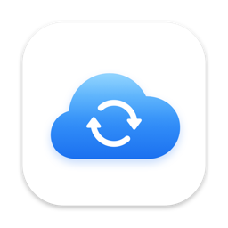

<p align="center">
  <picture>
    <source media="(prefers-color-scheme: dark)" srcset="docs/images/icon-dark.png">
    
  </picture>
</p>

<h1 align="center">Rclone GUI</h1>

<p align="center">轻量的 macOS 原生应用，基于 rclone 浏览、预览和备份你的云存储。</p>

<p align="center">
  
  
  <a href="https://rclone.org"></a>
  <a href="https://github.com/MIN202299/rclone-gui/releases/latest"></a>
  <a href="LICENSE"></a>
</p>

<p align="center"><a href="README.md">English</a> · <b>简体中文</b></p>

使用 SwiftUI 编写，无第三方依赖，底层由 [rclone](https://rclone.org) 驱动。它读取你现有的 `rclone.conf`，所以已经配置过的远端都会自动出现。

## 下载

在 [**Releases**](https://github.com/MIN202299/rclone-gui/releases/latest) 下载最新的 `Rclone-x.y.z.dmg`，打开后把 **Rclone** 拖到「应用程序」即可。支持 macOS 14 及以上版本，Apple 芯片和 Intel 都可以用。

应用目前还没有经过 Apple 公证，第一次打开会被 macOS 拦截。请到「系统设置 → 隐私与安全性」点击「仍要打开」，或在终端运行：

```bash
xattr -dr com.apple.quarantine /Applications/Rclone.app
```

## 功能

- **远端侧边栏**：每个远端带类型图标，并显示存储用量条（数据来自 `rclone about`，需要后端支持）。
- **类似 Finder 的文件浏览**：路径导航栏、前进/后退，文件列表可按名称、大小、修改时间排序，并可筛选。Google 在线文档、表格、幻灯片在云端没有固定大小，首次打开前显示「--」，打开过一次后显示本地缓存的导出文件大小。
- **文件操作**：新建文件夹、重命名、删除（会先确认）、复制路径，可在工具栏或右键菜单中使用。正在删除的项目会变暗并显示转圈，底部状态栏显示删除进度。
- **上传**：点工具栏按钮，或**直接把文件和文件夹从 Finder 拖进列表**。
- **下载**：下载到任意文件夹。
- **快速查看（Quick Look）**：用法和 Finder 一样，选中文件按空格（或 ⌘Y，或右键菜单里的「快速查看」）。预览打开时会跟随列表选中项切换，右上角可一键「用预览打开」。
- **文件缓存**：打开和预览过的文件会保存在 `~/Library/Caches/RcloneGUI/files`。如果云端文件没变（大小和修改时间都和文件列表一致），会直接打开本地缓存，不需要联网。对于无法保存修改时间的远端（例如部分 WebDAV 服务，像 OpenList），只比较大小，和 rclone 自身的做法一致。连不上云端时，会打开上次缓存的版本。缓存上限默认 2 GB，可在**设置**里修改；设置里还会显示已用空间，并提供「清除缓存」按钮。缓存位置也可以在设置里改到其他文件夹或外置硬盘（**更改…**）：缓存会放在所选文件夹下的 `Rclone Cache` 子文件夹里，修改时可以选择把已有缓存一起搬过去；如果外置硬盘没接上，会暂时使用默认位置，接回后自动恢复。超过上限时，最久没打开的文件会先被删除。访问过的文件夹会立即显示上次的列表，同时在后台刷新。
- **文件列表中的状态标记**：已缓存且和云端一致的文件会显示绿色对勾；文件正在下载、打开或预览时，那一行会显示进度圆环和百分比。
- **加载提示**：快速查看或打开的文件还在下载时，底部会出现一个浮动条，显示进度，并可以取消。
- **传输面板**：实时显示进度、速度和剩余时间，可以取消任务，下载完成后可「在 Finder 中显示」。
- **备份任务**：把一个本地文件夹和一个远端文件夹配成一对保存下来，之后随时再次备份。可以在工具栏的备份菜单里选「为此文件夹新建备份任务…」，也可以在「备份任务」窗口（⇧⌘S）里创建。备份只复制新增和修改过的文件（`rclone copy`），不会删除任何文件：一边删除的文件不会让另一边也被删除。每个任务可以选择方向：
  - **上传**：从本地文件夹复制到远端。本地删除的文件仍保留在远端。
  - **下载**：从远端复制到本地文件夹。远端删除的文件仍保留在本地。

  任务可以**手动**运行、**定时**运行（每 5 分钟到每天），也可以在**本地文件变化时**自动运行（仅上传）；只剩菜单栏图标时也会继续执行。「备份任务」窗口、菜单栏面板，以及已备份文件夹上方的横幅，都会显示每个任务的上次结果和实时进度，可以「立即备份」、停止、暂停或编辑。
- **菜单栏图标**：平时是一朵云，有任务进行时变成带同步箭头的云。点击可以查看每个任务的进度、取消任务或打开主窗口。关闭主窗口后应用仍在菜单栏运行，传输不会中断；点击 Dock 图标可以重新打开窗口。有备份、上传或下载正在进行时退出应用，会先弹窗确认；确认退出后，这些任务会被停止。
- **连接慢的远端也能快速响应**：应用会在后台常驻一个 `rclone rcd`，只监听本机 127.0.0.1，使用随机密码。退出应用时会一起关闭，即使应用被强制退出或崩溃也不会残留；旧版本遗留的后台 rclone 会在下次启动时自动清理。浏览文件夹和下载文件时复用已建立的连接，不必每次重新启动 rclone、重新登录。如果后台 rclone 无法启动，会自动退回每次单独运行 rclone 的方式。
- **添加远端向导**：根据 `rclone config providers` 生成，支持全部约 70 种后端。会列出必填和可选设置，rclone 后续的提问也在应用内完成，包括 Google Drive、Dropbox、OneDrive 等需要在浏览器中登录授权（OAuth）的服务。
- **移除远端**：只删除 rclone 配置中的这一项，不会动云端的任何文件。
- **多语言界面**：支持 English 和简体中文。默认跟随 macOS 的语言设置，也可以在**设置 → 通用 → 语言**中单独指定，重新启动应用后生效。
- **浅色/深色应用图标**：浅色版是白底加 iCloud 风格的蓝色渐变云朵；深色版是黑底加接近白色的云朵。在「系统设置 → 外观 → 图标与小组件样式」中选择「深色」后，macOS 会显示深色版。

## 系统要求

- macOS 14 或更高版本
- rclone。如果没有找到 rclone，应用会显示安装引导页，提供三种方式：
  - **Download & Install（下载安装）**：从 rclone.org 下载最新官方版本，并用官方公布的 SHA-256 校验值核对，安装到 `~/Library/Application Support/RcloneGUI/bin/rclone`，不需要管理员密码。
  - **Install with Homebrew（用 Homebrew 安装）**：执行 `brew install rclone`，并实时显示输出。只有装了 Homebrew 时才会出现这个选项。
  - **Choose rclone…（选择已有的 rclone）**：手动指定已安装的 rclone。

  查找 rclone 的顺序是：**设置（⌘,）** 中的自定义路径 → Homebrew → `/usr/local/bin` → `~/bin` → 应用自己安装的那一份。

## 构建与运行

构建需要安装 Xcode（用到 `swift` 和 `actool`）。

```bash
./scripts/bundle.sh          # 构建 build/Rclone.app（release 版，临时签名）
open build/Rclone.app
```

要安装的话，把 `build/Rclone.app` 复制到「应用程序」（`/Applications`）文件夹即可。

开发时可以用 `swift build && swift run`，或者用 Xcode 打开 `Package.swift`。

想在不影响真实配置的情况下试用，可以指定另一个配置文件启动：

```bash
open -n --env RCLONE_CONFIG=/path/to/test.conf build/Rclone.app
```

界面文字放在 `Resources/Localizable.xcstrings`（String Catalog）里，打包时编译进应用。新增或修改界面文字后运行 `./scripts/update-strings.sh`：它会从源码中重新提取文字、合并进目录，并列出还没有中文翻译的条目。翻译可以用 Xcode 打开该文件填写，也可以直接编辑 JSON。

在本地打包 DMG（加上 `UNIVERSAL=1` 可同时支持 Apple 芯片和 Intel）：

```bash
VERSION=1.2.3 ./scripts/bundle.sh && VERSION=1.2.3 ./scripts/make-dmg.sh   # → build/Rclone-1.2.3.dmg
```

### 发布新版本

推送一个版本 tag 即可。GitHub Actions（[`release.yml`](.github/workflows/release.yml)）会在 macOS 机器上构建通用版 DMG，并连同 `.sha256` 校验文件一起发布为 GitHub Release：

```bash
git tag v1.2.3 && git push origin v1.2.3
```

在 Actions 页面手动运行（Actions → Release → Run workflow）只会构建一个测试用 DMG 作为构建产物下载，不会发布 Release。

## 快捷键

| 按键 | 操作 |
| --- | --- |
| 空格 / ⌘Y | 快速查看 |
| 回车 / 双击 | 打开文件夹或文件 |
| ⌘R | 刷新 |
| ⌘[ / ⌘] | 后退 / 前进 |
| ⌘↑ | 上一级文件夹 |
| ⌫ | 删除选中项（会先确认） |
| ⇧⌘S | 备份任务 |
| ⌘, | 设置 |

## 目录结构

```
Sources/RcloneGUI/
  RcloneGUIApp.swift      应用入口、菜单、设置、Dock 重新打开窗口
  AppModel.swift          应用状态：远端、导航、文件操作、传输、快速查看
  Rclone.swift            rclone 命令行调用与 JSON 数据模型
  RcloneDaemon.swift      后台 `rclone rcd` 及其 HTTP 接口
  Transfer.swift          带实时进度和取消功能的传输任务（命令行或 rcd 任务）
  FileCache.swift         有容量上限、按最近使用淘汰的文件缓存
  RcloneInstaller.swift   下载并校验 rclone，或通过 Homebrew 安装
  ContentView.swift / SidebarView.swift / BrowserView.swift
  TransfersView.swift / AddRemoteView.swift / RcloneSetupView.swift
  MenuBarView.swift       菜单栏图标与任务面板
  SyncManager.swift       备份任务：执行、定时、监听本地文件变化
  SyncViews.swift         备份任务窗口、任务编辑器、文件夹横幅
  AppLanguage.swift       界面语言设置与重新启动
  QuitGuard.swift         有任务进行时退出前确认，退出时停止任务
Resources/AppIcon.icon    Icon Composer 图标文件（浅色 + 深色）
Resources/Localizable.xcstrings  界面文字及其翻译（English / 简体中文）
scripts/bundle.sh         把 release 构建打包成 .app
scripts/make-dmg.sh       把 .app 打包成 .dmg
scripts/update-strings.sh 从源码提取界面文字到 Localizable.xcstrings
.github/workflows/release.yml  推送 v* tag 时自动构建并发布 DMG
scripts/make-icon.swift   生成应用图标
```

## 许可证

MIT，详见 [LICENSE](LICENSE)。rclone 本身是另一个独立项目，同样使用 MIT 许可证。
